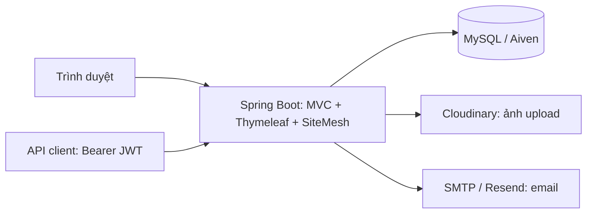

# OneShop — Website bán mỹ phẩm theo mô hình chuỗi cửa hàng

OneShop là đồ án website bán mỹ phẩm, xây dựng bằng **Spring Boot, Thymeleaf, Bootstrap, JPA, MySQL, SiteMesh, JWT và Cloudinary**. Dự án phục vụ giao diện khách hàng, trang quản trị và backend trong cùng một ứng dụng Java; dữ liệu tài khoản, giỏ hàng, đơn hàng và tồn kho được lưu bằng MySQL.

- **Website demo:** [oneshop-7gim.onrender.com](https://oneshop-7gim.onrender.com/)
- **Mã nguồn:** [KenvinTran9/Oneshop](https://github.com/KenvinTran9/Oneshop)
- **Triển khai:** Render Docker Web Service + Aiven MySQL + Cloudinary; email qua Resend trên môi trường deploy.

## Mục lục

- [Chức năng](#chức-năng)
- [Công nghệ và kiến trúc](#công-nghệ-và-kiến-trúc)
- [Cấu trúc thư mục](#cấu-trúc-thư-mục)
- [Cài đặt và chạy local](#cài-đặt-và-chạy-local)
- [Biến môi trường](#biến-môi-trường)
- [Cấu hình email và ảnh](#cấu-hình-email-và-ảnh)
- [Dữ liệu và nghiệp vụ đơn hàng](#dữ-liệu-và-nghiệp-vụ-đơn-hàng)
- [Các đường dẫn chính](#các-đường-dẫn-chính)
- [API xác thực JWT](#api-xác-thực-jwt)
- [Bảo mật](#bảo-mật)
- [Kiểm thử](#kiểm-thử)
- [Deploy Render và Aiven](#deploy-render-và-aiven)
- [Xử lý lỗi thường gặp](#xử-lý-lỗi-thường-gặp)
- [Phạm vi và hướng phát triển](#phạm-vi-và-hướng-phát-triển)
- [Tài liệu chi tiết](#tài-liệu-chi-tiết)

## Chức năng

### Khách hàng

- Trang chủ phong cách beauty editorial, banner tự chuyển sau 5 giây, giao diện thích ứng desktop và điện thoại.
- Xem danh mục, tìm theo tên/thương hiệu, lọc danh mục, sắp xếp và phân trang sản phẩm.
- Xem chi tiết, thư viện ảnh, phóng to ảnh; chọn màu, dung tích/kích thước khi sản phẩm có tùy chọn.
- Thêm, sửa số lượng và xóa sản phẩm trong giỏ. Giỏ khách chưa đăng nhập nằm trong session; giỏ tài khoản lưu MySQL và nhận các món từ giỏ khách khi đăng nhập trên web.
- Đăng ký, đăng nhập, đăng xuất; kiểm tra email trùng và xác nhận mật khẩu khi đăng ký.
- Quên mật khẩu: nhận liên kết xác thực qua email đã đăng ký, đặt mật khẩu mới bằng token dùng một lần, có hạn 15 phút.
- Đặt hàng giao tận nơi, thanh toán khi nhận hàng (**COD**).
- Nhận email xác nhận đơn nếu dịch vụ email đã được cấu hình và cho phép gửi đến địa chỉ đó.
- Xem lịch sử, chi tiết và timeline đơn của chính mình; hủy đơn khi còn chờ xác nhận.
- Xem thông tin hệ thống cửa hàng.

### Quản trị viên

- Trang tổng quan quản trị.
- Thêm, sửa, bật/tắt kinh doanh sản phẩm; chỉ tài khoản `ADMIN` được thao tác.
- Upload ảnh sản phẩm qua Cloudinary khi đã cấu hình.
- Xem danh sách, lọc và xử lý trạng thái đơn hàng.
- Đổi cửa hàng xử lý khi đơn còn `NEW`; hệ thống chuyển phần tồn kho đã giữ trong cùng transaction.
- Xem lịch sử xử lý và gửi lại email xác nhận khi cần.

### Dữ liệu mẫu

Catalog đi kèm gồm **100 sản phẩm, 59 thương hiệu, 5 danh mục** và dữ liệu màu/dung tích. Profile `dev` bổ sung dữ liệu còn thiếu cùng hai cửa hàng mẫu. Đây là bộ dữ liệu khởi tạo cho đồ án; số lượng thực tế có thể thay đổi khi quản trị viên cập nhật.

## Công nghệ và kiến trúc

| Thành phần | Công nghệ / vai trò |
| --- | --- |
| Ngôn ngữ | Java 21 |
| Framework | Spring Boot 3.5.16, Spring MVC |
| Giao diện | Thymeleaf, Bootstrap 5.3.8, Bootstrap Icons, CSS và JavaScript |
| Bố cục chung | SiteMesh 3.2.3, decorator riêng cho storefront và admin |
| Persistence | Spring Data JPA, Hibernate, MySQL 8.x |
| Xác thực web | Spring Security, form login và session |
| Xác thực API | Bearer JWT bằng JJWT 0.13.0 |
| Session production | Spring Session JDBC, lưu MySQL |
| Ảnh upload | Cloudinary SDK |
| Email | Spring Mail/Gmail SMTP hoặc Resend HTTPS |
| Build và triển khai | Maven, Docker nhiều giai đoạn, Render |
| Kiểm thử | JUnit, Spring Boot Test, MockMvc, Mockito; công cụ Python và Node.js |

Ứng dụng dùng kiến trúc MVC theo các lớp `controller → service → repository → MySQL`. DTO và validation nhận dữ liệu đầu vào; entity mô tả dữ liệu lưu trữ. Thymeleaf render HTML phía server, SiteMesh ghép bố cục chung.



Frontend và backend cùng origin, **không cần chạy một frontend Node.js riêng**. Mã nguồn hiện sử dụng MySQL; MongoDB không còn nằm trong luồng vận hành.

## Cấu trúc thư mục

```text
OneShop/
├── src/main/java/com/oneshop/
│   ├── api/                 # API xác thực JWT
│   ├── config/              # Security, SiteMesh, session, khởi tạo dữ liệu
│   ├── controller/          # Trang khách hàng và quản trị
│   ├── dto/                 # Request, response, dữ liệu hiển thị
│   ├── entity/              # JPA entities
│   ├── repository/          # Truy vấn dữ liệu
│   ├── security/            # JWT và các thành phần xác thực
│   ├── service/             # Nghiệp vụ sản phẩm, giỏ, đơn, email
│   └── validation/          # Validation bổ sung
├── src/main/resources/
│   ├── catalog/             # Catalog và ánh xạ ảnh màu
│   ├── db/                  # SQL bổ sung cho khôi phục mật khẩu
│   ├── static/              # CSS, JavaScript, ảnh và decorators SiteMesh
│   ├── templates/           # Thymeleaf pages và mẫu email
│   └── application*.yml     # Cấu hình chung / dev / prod
├── src/test/                # Kiểm thử Java
├── deploy/                  # Script khởi động Docker, env mẫu
├── tools/                   # Chuyển dữ liệu, chuẩn bị deploy, kiểm tra UI
├── docs/                    # Tài liệu từng chức năng
├── .env.example             # Mẫu cấu hình local, không chứa khóa thật
├── Dockerfile
├── render.yaml
└── pom.xml
```

## Cài đặt và chạy local

### 1. Chuẩn bị

- JDK **21**, Maven và MySQL **8.x** đang chạy; môi trường phát triển hiện dùng MySQL 8.4.
- Git để lấy mã nguồn.
- Python 3 nếu sử dụng công cụ chuyển dữ liệu/deploy; Node.js nếu chạy các bài kiểm tra JavaScript.
- Tài khoản Cloudinary và dịch vụ email nếu muốn thử upload/gửi mail thật.

```powershell
git clone https://github.com/KenvinTran9/Oneshop.git
cd Oneshop
java -version
mvn -version
```

### 2. Tạo database

Chạy SQL sau **trong MySQL Workbench hoặc MySQL client**, bằng tài khoản có quyền tạo database:

```sql
CREATE DATABASE oneshop_mysql
  CHARACTER SET utf8mb4
  COLLATE utf8mb4_0900_as_ci;
```

### 3. Tạo cấu hình riêng

```powershell
Copy-Item .env.example .env
```

Mở `.env`, điền `MYSQL_USERNAME`, `MYSQL_PASSWORD` và thay `JWT_SECRET` bằng khóa riêng. Giữ URL MySQL local theo file mẫu nếu dùng cổng `3306` và database `oneshop_mysql`.

Tạo khóa JWT Base64 từ 32 byte ngẫu nhiên bằng PowerShell, rồi chép kết quả vào `.env`:

```powershell
$jwtBytes = New-Object byte[] 32
$jwtRng = [System.Security.Cryptography.RandomNumberGenerator]::Create()
$jwtRng.GetBytes($jwtBytes)
[Convert]::ToBase64String($jwtBytes)
$jwtRng.Dispose()
```

Profile `dev` đọc `.env` dưới dạng **Java properties**: mỗi dòng `KEY=value`, không thêm `export` hoặc dấu nháy bao quanh giá trị. File `.env` là riêng tư và đã được Git bỏ qua.

### 4. Chạy ứng dụng

```powershell
mvn spring-boot:run '-Dspring-boot.run.profiles=dev'
```

Mở [http://localhost:8080](http://localhost:8080). Cần chọn profile rõ ràng; `dev` cho phát triển, `prod` cho triển khai.

Nếu VS Code/JDT làm lẫn file biên dịch trong `target/classes`, dùng thư mục build riêng. Ví dụ với repo tại `C:\OneShop`:

```powershell
$env:JAVA_HOME = 'C:\Program Files\Java\jdk-21'
mvn spring-boot:run '-Doneshop.build.directory=C:\OneShop\target\mysql-build' '-Dspring-boot.run.profiles=dev' '-Dspring-boot.run.jvmArguments=-Djdk.net.unixdomain.tmpdir=C:\OneShop\target'
```

Thay các đường dẫn trên theo thư mục cài đặt thực tế. Tham số `jdk.net.unixdomain.tmpdir` hỗ trợ tránh lỗi đường dẫn tạm Unix-domain socket trên một số máy Windows.

### 5. Tài khoản demo và seed

| Vai trò | Email | Mật khẩu |
| --- | --- | --- |
| Admin mẫu | `admin@oneshop.vn` | Giá trị tự đặt trong `DEMO_ADMIN_PASSWORD` |
| Khách mẫu | `khachhang@oneshop.vn` | Giá trị tự đặt trong `DEMO_CUSTOMER_PASSWORD` |

Điền hai biến này trước khi khởi động `dev` nếu cần tạo tài khoản mẫu. Để trống thì bỏ qua tạo tài khoản tương ứng. **Không có mật khẩu mặc định được công bố.** Thay biến sau khi tài khoản đã tồn tại không đổi mật khẩu của tài khoản đó.

Trong `dev`, Hibernate dùng `ddl-auto=update`. Bộ seed bổ sung SKU còn thiếu, không ghi đè thông tin sản phẩm đã chỉnh. Tồn kho mẫu là **20 đơn vị/SKU tại `HCM-D1`** khi chưa có bản ghi; tồn đã tồn tại, kể cả bằng 0, được giữ nguyên.

- `APP_DEV_SEED_STOCK=false`: tắt khởi tạo tồn mẫu.
- `APP_SEED_ENABLED=false`: tắt bộ seed dữ liệu demo.
- `prod`: không seed sản phẩm, tồn mẫu hoặc admin. Cần chuẩn bị dữ liệu/admin trước khi deploy; các role hệ thống được bổ sung nếu thiếu.

## Biến môi trường

Các file tham chiếu: [.env.example](.env.example), [deploy/render.env.example](deploy/render.env.example) và [deploy/aiven.env.example](deploy/aiven.env.example).

| Nhóm | Biến | Ý nghĩa |
| --- | --- | --- |
| Runtime | `SPRING_PROFILES_ACTIVE`, `PORT` | Profile khi deploy và cổng HTTP; cổng mặc định 8080 |
| Database | `MYSQL_URL`, `MYSQL_USERNAME`, `MYSQL_PASSWORD` | JDBC URL và tài khoản MySQL |
| TLS production | `MYSQL_CA_CERT_PATH`, `MYSQL_CA_CERT_BASE64` | Đường dẫn CA hoặc nội dung CA mã hóa Base64 cho script Docker |
| JWT | `JWT_SECRET`, `JWT_ISSUER` | Khóa Base64 tối thiểu 32 byte ngẫu nhiên và issuer |
| JWT | `JWT_ACCESS_TOKEN_EXPIRATION_MILLIS`, `JWT_REFRESH_TOKEN_EXPIRATION_MILLIS` | Mặc định mẫu: 900000 ms và 604800000 ms |
| Seed dev | `DEMO_ADMIN_PASSWORD`, `DEMO_CUSTOMER_PASSWORD`, `APP_SEED_ENABLED`, `APP_DEV_SEED_STOCK` | Tạo dữ liệu demo có kiểm soát |
| Cloudinary | `CLOUDINARY_CLOUD_NAME`, `CLOUDINARY_API_KEY`, `CLOUDINARY_API_SECRET` | Upload ảnh sản phẩm |
| Email | `MAIL_ENABLED`, `MAIL_PROVIDER`, `MAIL_FROM` | Bật gửi, chọn `smtp`/`resend`, địa chỉ người gửi |
| SMTP | `MAIL_HOST`, `MAIL_PORT`, `MAIL_USERNAME`, `MAIL_PASSWORD` | Gmail SMTP hoặc máy chủ tương thích |
| Resend | `RESEND_API_KEY` | Khóa gửi email qua HTTPS |
| URL | `APP_BASE_URL` | URL công khai dùng trong liên kết email |
| Đơn hàng | `ORDER_SHIPPING_FEE` | Phí giao hàng, mặc định 30000 đồng |

Production nhận cấu hình qua environment/secret manager, không tự đọc `.env` local. Không đưa mật khẩu, API secret, token hoặc backup dữ liệu lên Git.

## Cấu hình email và ảnh

### Gmail SMTP khi chạy local

Bật xác minh hai bước cho Gmail và tạo **App Password**. Điền trực tiếp trong `.env`:

```ini
MAIL_ENABLED=true
MAIL_PROVIDER=smtp
MAIL_HOST=smtp.gmail.com
MAIL_PORT=587
MAIL_USERNAME=your-email@gmail.com
MAIL_PASSWORD=YOUR_GOOGLE_APP_PASSWORD
MAIL_FROM=your-email@gmail.com
APP_BASE_URL=http://localhost:8080
```

Không dùng mật khẩu đăng nhập Gmail thông thường; bỏ khoảng trắng trong App Password. Khởi động lại ứng dụng sau khi đổi cấu hình.

### Resend trên bản deploy

Cấu hình hỗ trợ Render Free của dự án dùng HTTPS thay cho Gmail SMTP:

```ini
MAIL_ENABLED=true
MAIL_PROVIDER=resend
MAIL_FROM=onboarding@resend.dev
RESEND_API_KEY=YOUR_RESEND_API_KEY
APP_BASE_URL=https://YOUR_SERVICE.onrender.com
```

Với địa chỉ thử `onboarding@resend.dev`, Resend giới hạn người nhận ở email chủ tài khoản. Muốn gửi cho khách bất kỳ, cần xác thực tên miền trong Resend và dùng địa chỉ gửi thuộc tên miền đó. Gmail đăng ký Resend là email nhận thử, không tự trở thành địa chỉ `MAIL_FROM` hợp lệ.

Email đơn hàng được gửi sau khi lưu đơn; lỗi gửi không xóa đơn đã đặt. Admin có thể xem kết quả và gửi lại. Bật mail không tự gửi lại mọi đơn cũ. Luồng quên mật khẩu cũng cần cấu hình email hoạt động và `APP_BASE_URL` đúng; xem [khôi phục mật khẩu](docs/password-reset.md).

### Cloudinary

Điền ba biến `CLOUDINARY_CLOUD_NAME`, `CLOUDINARY_API_KEY`, `CLOUDINARY_API_SECRET` rồi khởi động lại. Đăng nhập admin và thử upload khi tạo/sửa sản phẩm. Ảnh upload được kiểm tra nội dung, giới hạn **5 MB mỗi file**.

Ảnh catalog/banner đi kèm vẫn nằm trong `src/main/resources/static/images`; không phải tất cả ảnh đều được chuyển lên Cloudinary. Không dùng ổ đĩa tạm của Render để lưu ảnh upload lâu dài.

## Dữ liệu và nghiệp vụ đơn hàng

### Các bảng chính

| Nhóm | Bảng |
| --- | --- |
| Tài khoản | `users`, `roles`, `password_reset_accounts` |
| Catalog | `products`, `brands`, `categories`, `product_shades`, `product_sizes` |
| Chuỗi cửa hàng | `stores`, `store_stocks` |
| Giỏ hàng | `shopping_carts`, `shopping_cart_items` |
| Đơn hàng | `orders`, `order_items`, `order_events` |
| Session production | `SPRING_SESSION`, `SPRING_SESSION_ATTRIBUTES` |

Khách đăng ký web được lưu trong **`users`**. Mục **Users** trên Aiven là tài khoản truy cập database, không phải danh sách khách hàng của OneShop.

Để xem tài khoản bằng MySQL Workbench, kết nối đúng server và chạy truy vấn chỉ đọc:

```sql
-- Local: oneshop_mysql. Aiven: defaultdb, nếu giữ tên database mặc định.
SELECT id, full_name, email, phone, active, created_at
FROM defaultdb.users
ORDER BY id DESC
LIMIT 50;
```

Local và Aiven là hai database riêng khi JDBC URL được cấu hình như các ví dụ trên. Ứng dụng lưu vào server/database mà `MYSQL_URL` chỉ định; chạy trên máy cá nhân vẫn có thể ghi vào Aiven nếu đổi URL sang Aiven. Hai nơi không tự đồng bộ dữ liệu.

Tài khoản, sản phẩm, giỏ của tài khoản và đơn hàng trong MySQL vẫn còn sau khi tắt/chạy lại ứng dụng. Riêng giỏ khách chưa đăng nhập nằm trong session: profile `dev` giữ session trong bộ nhớ nên giỏ này có thể mất khi restart; profile `prod` lưu session qua JDBC, còn phụ thuộc thời hạn session và cookie của trình duyệt. Mật khẩu trong bảng được băm BCrypt, không đọc lại được dưới dạng mật khẩu gốc.

### Luồng đặt và xử lý đơn

1. Khách đăng nhập, kiểm tra giỏ và nhập tên, điện thoại, địa chỉ, ghi chú.
2. Backend tính lại giá, phí giao hàng và kiểm tra tùy chọn; không tin tổng tiền từ trình duyệt.
3. Hệ thống tự chọn cửa hàng đang hoạt động, đủ toàn bộ giỏ; giữ/trừ tồn trong transaction và chống gửi lặp checkout.
4. Tạo đơn và lịch sử; gửi email xác nhận nếu đã bật dịch vụ.
5. Admin xử lý đơn; khách theo dõi trong tài khoản.

```text
NEW → CONFIRMED → PACKING → SHIPPING → COMPLETED
  └──────┴─────────┴─────→ CANCELLED
```

Khách chỉ tự hủy đơn của mình ở `NEW`. Admin có thể hủy trước khi giao (`NEW`, `CONFIRMED`, `PACKING`); tồn được hoàn đúng một lần. Admin chỉ đổi cửa hàng ở `NEW`; cửa hàng mới phải đủ tồn và thao tác chuyển được rollback nếu không đáp ứng.

Tồn kho hiện quản lý theo **SKU và cửa hàng**; các màu/dung tích dùng chung tồn SKU. Chưa chia một đơn ra nhiều cửa hàng và chưa có tồn độc lập cho từng biến thể.

## Các đường dẫn chính

| Đường dẫn | Chức năng / quyền |
| --- | --- |
| `/` | Trang chủ |
| `/products`, `/products/{slug}` | Danh sách và chi tiết sản phẩm |
| `/stores` | Hệ thống cửa hàng |
| `/register`, `/login` | Đăng ký, đăng nhập |
| `/forgot-password`, `/reset-password` | Yêu cầu và thực hiện đặt lại mật khẩu |
| `/cart` | Giỏ hàng |
| `/checkout` | Đặt hàng, yêu cầu đăng nhập |
| `/orders`, `/orders/{code}` | Đơn thuộc tài khoản đang đăng nhập |
| `/admin` | Tổng quan, yêu cầu `ADMIN` |
| `/admin/products` | Quản trị sản phẩm, yêu cầu `ADMIN` |
| `/admin/orders` | Quản trị đơn, yêu cầu `ADMIN` |
| `/healthz` | Health check |

Các thao tác ghi dữ liệu trên web dùng POST và CSRF token; đăng xuất thực tế bằng POST.

## API xác thực JWT

Web Thymeleaf dùng **session**; API `/api/**` dùng **Bearer JWT**. Cookie đăng nhập web không thay cho token API.

| Method | Endpoint | Nội dung |
| --- | --- | --- |
| POST | `/api/auth/login` | Nhận email/mật khẩu, trả access token và refresh token |
| POST | `/api/auth/refresh` | Nhận refresh token, cấp token theo chính sách hiện tại |
| GET | `/api/auth/me` | Thông tin tài khoản, cần access token |

Ví dụ PowerShell trên máy local:

```powershell
$loginBody = @{ email = 'YOUR_EMAIL'; password = 'YOUR_PASSWORD' } | ConvertTo-Json
$tokens = Invoke-RestMethod -Method Post -Uri 'http://localhost:8080/api/auth/login' -ContentType 'application/json' -Body $loginBody
Invoke-RestMethod -Uri 'http://localhost:8080/api/auth/me' -Headers @{ Authorization = "Bearer $($tokens.accessToken)" }

$refreshBody = @{ refreshToken = $tokens.refreshToken } | ConvertTo-Json
Invoke-RestMethod -Method Post -Uri 'http://localhost:8080/api/auth/refresh' -ContentType 'application/json' -Body $refreshBody
```

Không ghi token/mật khẩu thật vào script được commit. Đăng xuất web kết thúc session web; đổi mật khẩu qua luồng khôi phục sẽ vô hiệu hóa token cũ và session cũ ở lần kiểm tra tiếp theo.

## Bảo mật

- Phân quyền URL và nghiệp vụ quản trị; khách không được xem hoặc sửa đơn người khác.
- Chuẩn hóa email và ràng buộc duy nhất ở database; mật khẩu được băm BCrypt.
- CSRF cho form web; API JWT stateless, kiểm tra chữ ký, issuer và loại token.
- Production dùng cookie `Secure`, `HttpOnly`, `SameSite=Lax`; session có thời gian chờ 30 phút.
- Token khôi phục được sinh ngẫu nhiên, chỉ lưu SHA-256 digest, hết hạn sau 15 phút và dùng một lần.
- Giới hạn tần suất xác thực/khôi phục theo cấu hình hiện tại; trạng thái giới hạn nằm trong từng instance, chưa phải cơ chế phân tán.
- Header CSP và các header chống nhúng trang; trang reset không cache và hạn chế lộ URL token qua referrer.
- MySQL production xác minh chứng chỉ và hostname qua `VERIFY_IDENTITY`.
- Docker chạy bằng user không phải root; `.env`, backup và test không được đóng gói vào image.

Các biện pháp trên là phạm vi đã triển khai trong đồ án, không thay thế kiểm toán bảo mật trước khi vận hành thương mại.

## Kiểm thử

Chạy từ thư mục gốc, với MySQL local và thông tin đăng nhập trong `.env`:

```powershell
mvn clean verify
python tools/test_aiven_deploy.py
node tools/test_shop_motion.cjs
node tools/test_shade_gallery.cjs
```

Trên Windows tại `C:\OneShop`, có thể dùng build riêng và thư mục tạm ngắn:

```powershell
mvn clean verify '-Doneshop.build.directory=C:\OneShop\target\mysql-build' '-DargLine=-Djdk.net.unixdomain.tmpdir=C:\OneShop\target'
```

Bộ kiểm thử tích hợp tạo schema riêng `oneshop_test_<uuid>` rồi dọn schema đó khi kết thúc. Tài khoản test cần quyền tạo/xóa database trên server test. Có thể đặt `ONESHOP_TEST_MYSQL_URL` để chọn server test riêng; tên database vẫn được thay bằng schema ngẫu nhiên. Không dùng tài khoản production để chạy test.

Phạm vi kiểm thử gồm đăng ký/xác thực/phân quyền, JWT, khôi phục mật khẩu, giỏ và checkout, tồn kho, trạng thái đơn, quản trị sản phẩm, JDBC session và ngân sách truy vấn catalog. Kiểm thử email/upload dùng mock, không thay thế việc gửi thử hoặc upload thật sau khi cấu hình dịch vụ.

Để đóng gói JAR sau khi các kiểm tra đã đạt:

```powershell
mvn package -DskipTests
java -jar target/oneshop-0.0.1-SNAPSHOT.jar --spring.profiles.active=dev
```

## Deploy Render và Aiven

Hướng dẫn từng bước: **[docs/deploy-render-aiven.md](docs/deploy-render-aiven.md)**.

### 1. Chuẩn bị Aiven và chuyển dữ liệu

Tạo MySQL service, kiểm tra đúng plan mong muốn trong Service settings, lấy thông tin kết nối và tải CA certificate. Sao chép mẫu cấu hình:

```powershell
Copy-Item deploy/aiven.env.example .env.aiven
```

Điền `.env.aiven` trực tiếp trên máy; lưu CA tại `backups/aiven-ca.pem` theo mẫu. Cần Python 3 cùng MySQL client `mysql` và `mysqldump`. Chạy bản local mới nhất trước để bổ sung schema cần thiết, sau đó:

```powershell
python tools/migrate_aiven.py
python tools/migrate_aiven.py --migrate
python tools/prepare_render.py
```

- Lệnh đầu chỉ kiểm tra kết nối/TLS và dữ liệu.
- `--migrate` chỉ nhập khi database đích **chưa có bảng**; tạo backup và đối chiếu số bản ghi, không tự ghi đè database đang dùng.
- Công cụ không chuyển session đang đăng nhập. Tránh thay đổi dữ liệu local trong lúc xuất snapshot.
- `prepare_render.py` tạo `.env.render` riêng để nhập vào Render, không commit file này.

### 2. Tạo Web Service

Đưa mã đã kiểm tra lên GitHub, sau đó trong Render chọn:

| Trường | Giá trị |
| --- | --- |
| Loại service | Web Service |
| Repository | Repo OneShop của bạn |
| Branch | `main`, hoặc nhánh chứa cấu hình deploy |
| Language | Docker |
| Root Directory | Để trống nếu `Dockerfile` ở gốc repo |
| Dockerfile Path | `./Dockerfile` |
| Compute | Free nếu dùng bản demo miễn phí |
| Health Check Path | `/healthz` |
| Environment | Nhập `.env.render`, mỗi tên biến chỉ có một dòng |

Đặt `SPRING_PROFILES_ACTIVE=prod`. Cung cấp CA bằng `MYSQL_CA_CERT_BASE64` do công cụ tạo, hoặc Secret File `/etc/secrets/aiven-ca.pem`. Cấu hình Cloudinary, email và `APP_BASE_URL` theo tên miền thực tế. Có thể dùng [render.yaml](render.yaml) làm Blueprint thay cho tạo thủ công.

Render tự build/chạy Docker trên server; **không cần bật Docker Desktop trên máy cá nhân** để website đã deploy hoạt động. Khi đổi mã cần commit/push, còn đổi biến môi trường cần lưu và redeploy/restart service.

### 3. Dữ liệu, schema và vận hành

- Production dùng Hibernate **`validate`**: cần có schema ứng dụng trước khi khởi động. SQL bổ sung bảng khôi phục mật khẩu và bảng JDBC session chỉ xử lý các phần tương ứng, không thay thế việc chuẩn bị toàn bộ schema.
- Dữ liệu nghiệp vụ nằm ở Aiven, ảnh upload ở Cloudinary; restart container không được dùng như cách lưu dữ liệu.
- Session production lưu MySQL; file static đi theo Docker image.
- Email không hoạt động chỉ vì website đã truy cập được: cần bật provider, khóa hợp lệ và địa chỉ gửi/nhận được phép.
- Cấu hình gói dịch vụ do nhà cung cấp quyết định; xem dashboard và tài liệu hiện hành trước khi chọn plan.

Sau deploy, kiểm tra `/healthz`, đăng ký/đăng nhập, giỏ, đặt đơn, admin, ảnh upload, email và dữ liệu sau restart. Dùng admin đã chuẩn bị/migrate; production không tự tạo tài khoản admin demo.

## Xử lý lỗi thường gặp

| Hiện tượng | Kiểm tra / cách xử lý |
| --- | --- |
| MySQL `Access denied` | Kiểm tra user, mật khẩu, host và quyền; phân biệt tài khoản local với Aiven. SQL cần chạy trong MySQL client, không gõ trực tiếp vào PowerShell. |
| `Unknown database` | Tạo đúng database, đối chiếu tên trong JDBC URL. |
| Render không tìm thấy `Dockerfile` | Kiểm tra file đã lên đúng branch, Root Directory và Dockerfile Path. |
| Trùng Environment key | Giữ đúng một dòng cho mỗi biến; tránh import nhiều lần tạo bản trùng. |
| Prod báo thiếu bảng/cột | Đối chiếu phiên bản schema với mã nguồn; không đổi sang `ddl-auto=create` vì có thể mất dữ liệu. |
| Kết nối Aiven lỗi TLS | Kiểm tra hostname/port, CA certificate và cấu hình truststore; giữ xác minh chứng chỉ. |
| Email chưa đến | Kiểm tra provider, `MAIL_ENABLED`, App Password/API key, log gửi và spam; Resend thử chỉ gửi đến địa chỉ được phép. |
| Link reset trỏ localhost | Đặt `APP_BASE_URL` thành URL HTTPS của website rồi restart. |
| Admin không upload được ảnh | Kiểm tra ba biến Cloudinary, định dạng/nội dung file và giới hạn 5 MB. |
| Không có admin sau deploy | Chuẩn bị admin ở local rồi migrate; biến demo chỉ áp dụng khi tạo tài khoản mới ở `dev`. |
| Tồn kho bằng 0 dù có sản phẩm | Catalog và tồn cửa hàng là dữ liệu riêng; seed không ghi đè bản ghi tồn đã có. |
| Render truy cập đầu chậm | Có thể là service Free đang khởi động lại sau thời gian không hoạt động; xem Events/Logs, CPU/RAM và kết nối database. Các request tiếp theo vẫn chậm thì kiểm tra thêm truy vấn và mạng. |
| Port 8080 đã được sử dụng | Kiểm tra tiến trình đang chạy hoặc đổi `PORT`; tránh khởi động nhiều bản cùng cổng. |

Xem thêm [phân tích hiệu năng](docs/performance.md). Dự án đã giảm truy vấn catalog, tải session không cần thiết cho file static, gộp dữ liệu header và bật nén HTTP production; các tối ưu này không loại bỏ thời gian khởi động của hạ tầng.

## Phạm vi và hướng phát triển

Đây là **đồ án có luồng mua hàng và backend lưu dữ liệu**, chưa phải hệ thống thương mại hoàn thiện mọi nghiệp vụ. Những phần có thể tiếp tục phát triển:

- Thanh toán trực tuyến và đối soát; hiện chỉ COD.
- Tích hợp đơn vị vận chuyển, vận đơn và trạng thái giao hàng thực tế.
- UI quản trị khách hàng, cửa hàng và nhập/xuất/điều chuyển kho đầy đủ.
- Phân quyền nhân viên theo chi nhánh; tồn kho độc lập theo biến thể.
- Chia đơn nhiều kho, mã giảm giá và chương trình khách hàng thân thiết.
- Tên miền email đã xác thực để gửi cho mọi khách, giám sát gửi và retry bền vững.
- Quy trình migration schema có phiên bản, backup/restore định kỳ, monitoring và rate limit phân tán khi mở rộng nhiều instance.
- Bổ sung ERD, báo cáo và kịch bản demo theo rubric của môn học.

## Tài liệu chi tiết

| Tài liệu | Nội dung |
| --- | --- |
| [MySQL](docs/mysql.md) | Chạy và sử dụng database |
| [Tài khoản](docs/accounts.md) | Đăng ký, đăng nhập, phân quyền |
| [Bảo mật backend](docs/backend-security.md) | Các lớp bảo vệ và giới hạn |
| [Giỏ và tùy chọn](docs/cart-selections.md) | Màu, dung tích, giỏ hàng |
| [Đơn hàng](docs/orders.md) | Checkout, tồn và xử lý đơn |
| [Khôi phục mật khẩu](docs/password-reset.md) | Token, email và cấu hình |
| [Deploy Render + Aiven](docs/deploy-render-aiven.md) | Chuyển dữ liệu và triển khai |
| [Hiệu năng](docs/performance.md) | Tối ưu và cách đo |
| [Ảnh catalog](docs/catalog-images.md) | Quản lý ảnh sản phẩm |
| [Giao diện editorial](docs/editorial-storefront.md) | Bố cục storefront |
| [Đối chiếu yêu cầu đồ án](docs/project-requirements.md) | Công nghệ và phạm vi yêu cầu; một số ghi chú phản ánh thời điểm kiểm tra riêng |

**OneShop · 2026**
