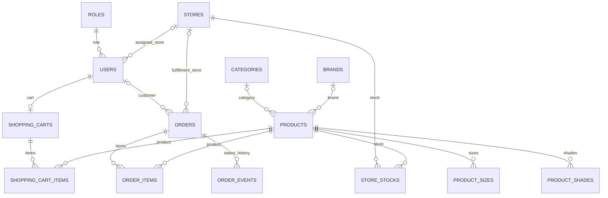

# Backend JPA + MySQL

OneShop dùng Java 21, Spring Boot 3.5.16, Spring Data JPA/Hibernate và MySQL. Bản local hiện kết nối MySQL 8.4.13, database `oneshop_mysql`. MongoDB không còn là dependency của ứng dụng.

## Cấu hình và chạy local

Trong `.env` ở thư mục gốc, đặt `MYSQL_URL`, `MYSQL_USERNAME` và `MYSQL_PASSWORD` theo `.env.example`. Không đưa mật khẩu/API key thật lên Git. Profile `dev` nạp `.env` như Java properties; các giá trị không cần dấu nháy. Nếu mật khẩu chứa dấu gạch chéo ngược, phải escape theo cú pháp properties.

Tạo database mới trước lần chạy đầu:

```sql
CREATE DATABASE oneshop_mysql CHARACTER SET utf8mb4 COLLATE utf8mb4_0900_as_ci;
```

```powershell
$env:JAVA_HOME = 'C:\Program Files\Java\jdk-21'
mvn spring-boot:run '-Dspring-boot.run.profiles=dev'
```

Truy cập `http://localhost:8080/`. Trong Workbench, dùng hostname `127.0.0.1`, port `3306`, và tài khoản MySQL đã cấu hình. Tài khoản MySQL khác với tài khoản khách hàng/admin của website.

Profile `dev` dùng `ddl-auto=update` cho local. Profile `prod` dùng `validate`, không tự sửa schema hay nạp dữ liệu demo; phải tạo schema trước. File [schema/mysql.sql](schema/mysql.sql) chứa DDL không có dữ liệu để khởi tạo một database mới. Không dùng tài khoản root hoặc kết nối không xác minh TLS cho triển khai từ xa.

## Cấu trúc dữ liệu

14 bảng: `roles`, `users`, `stores`, `categories`, `brands`, `products`, `product_sizes`, `product_shades`, `store_stocks`, `shopping_carts`, `shopping_cart_items`, `orders`, `order_items`, `order_events`.



- ID số tự tăng, khóa ngoại và unique constraint được định nghĩa bằng JPA.
- `BigDecimal` lưu dưới dạng `DECIMAL`; dữ liệu tiếng Việt dùng `utf8mb4`.
- `@Version` ngăn ghi đè bản ghi đã bị thay đổi; thời gian tạo/cập nhật dùng JPA auditing.
- Giỏ có quan hệ một-nhiều, cascade và orphan removal. Mỗi lần thay đổi giỏ chạy trong SQL transaction và khóa bản ghi tài khoản để tránh hai yêu cầu cùng tạo hoặc ghi giỏ đầu tiên.
- Màu và quy cách là element collections có thứ tự; mỗi dòng giỏ giữ lựa chọn riêng.
- `open-in-view=false`; service khởi tạo các quan hệ cần hiển thị trước khi render Thymeleaf.

## Dữ liệu mẫu

Các role nền được tạo khi thiếu. Profile `dev` bổ sung SKU/cửa hàng thiếu và tạo 20 tồn mẫu mỗi SKU ở `HCM-D1` khi chưa có cặp tồn. Không ghi đè dữ liệu đã chỉnh hoặc số tồn bằng 0. `APP_DEV_SEED_STOCK=false` tắt tồn mẫu; `APP_SEED_ENABLED=false` tắt tất cả bộ nạp, dùng khi chuẩn bị schema để nhập dữ liệu.

Khách đặt hàng không chọn cửa hàng. Backend khóa tồn theo thứ tự ID cửa hàng/sản phẩm và tự giữ hàng ở một cửa hàng hoạt động có đủ toàn bộ giỏ. Admin có thể phân công lại khi đơn còn `NEW`: hoàn giữ hàng ở kho cũ và giữ tại kho mới trong cùng giao dịch; thiếu hàng thì không chuyển. Hủy đơn hoàn tồn về cửa hàng đang phụ trách. Phân công yêu cầu quyền ADMIN và CSRF, được ghi vào lịch sử đơn, không tự gửi thêm email.

## Chuyển đổi và sao lưu

Ngày 29/10/2026, dữ liệu OneShop được xuất từ MongoDB và nhập vào schema MySQL riêng, giữ ID và quan hệ. `tools/mongo_snapshot_to_mysql.py` chuyển canonical EJSON thành SQL transaction, giữ giá decimal, ngày giờ local, màu/quy cách và các dòng giỏ. Công cụ từ chối ghi đè file đầu ra. Chỉ nhập vào schema đã được xác minh trống.

Ngày 30/10/2026, trước khi cài lại MySQL, đã xuất riêng 4 database người dùng vào `backups/before-reinstall-2026-10-30/`. Các file này bị loại khỏi Git và có quyền truy cập giới hạn. Bản sao `oneshop_mysql.sql` đã được khôi phục thử trong schema ngẫu nhiên, xác nhận đủ 100 sản phẩm, 100 tồn kho, 100 quy cách và 62 màu. Schema thử sau đó được xóa.

Sau khi MySQL 8.4 được cấu hình, bản sao đã được khôi phục vào server mới, kiểm tra checksum trước khi nhập. Luồng nhập phải dùng UTF-8 rõ ràng: khi dùng Python subprocess, đặt `encoding='utf-8'`; khi dùng .NET Process, đặt `StandardInputEncoding` thành UTF-8 trước khi khởi chạy. Không dựa vào encoding mặc định của PowerShell/console. Sau khi nhập đã đối chiếu byte UTF-8 của tên danh mục tiếng Việt với nguồn.

Dữ liệu xác nhận: 100 sản phẩm, 59 thương hiệu, 5 danh mục, 2 cửa hàng, 100 bản ghi tồn và 62 lựa chọn màu. Tại thời điểm sao lưu chưa có tài khoản khách hoặc giỏ tài khoản; chức năng này được kiểm tra bằng tài khoản thử trong schema riêng.

## Kiểm thử

```powershell
mvn verify '-Doneshop.build.directory=C:\OneShop\target\mysql-build' '-DargLine=-Djdk.net.unixdomain.tmpdir=C:\OneShop\target'
python tools/test_mysql_migration.py
```

`MySqlIntegrationTestSupport` tạo schema ngẫu nhiên `oneshop_test_<uuid>`, thay database trong JDBC URL và xác minh chính xác tên schema trước khi xóa fixture hoặc dọn schema. Tài khoản test cần quyền tạo/xóa schema thử; không dùng cơ chế dọn fixture với database ứng dụng.

Các bài kiểm tra bao gồm đăng ký/BCrypt, đăng nhập session, JWT, quyền admin, CRUD sản phẩm, ảnh upload qua mock Cloudinary, giỏ hàng, khóa ngoại, unique constraint, version và lỗi form qua HTTP/Tomcat thật.

Tham khảo: [Spring Boot external configuration](https://docs.spring.io/spring-boot/3.5/reference/features/external-config.html), [MySQL database character sets](https://dev.mysql.com/doc/refman/8.0/en/charset-database.html).
